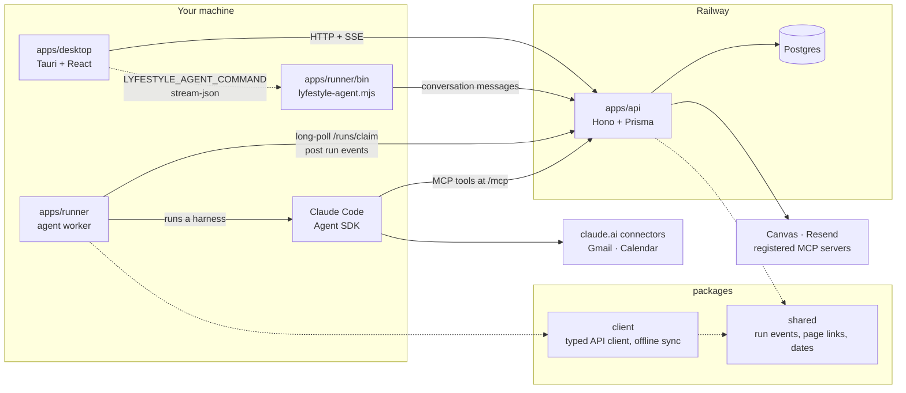

# Lyfestyle

A personal knowledge and productivity hub where markdown pages, a planner and a Claude agent (chat, scheduled automations, Gmail/Calendar/Canvas/email tools) live behind one API and a Tauri desktop app.

